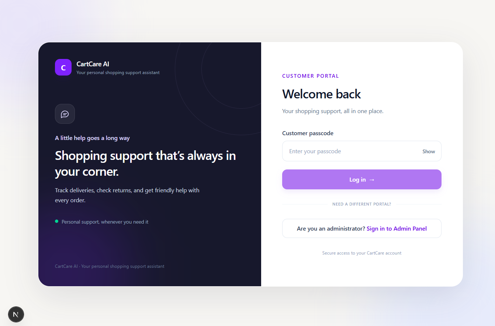
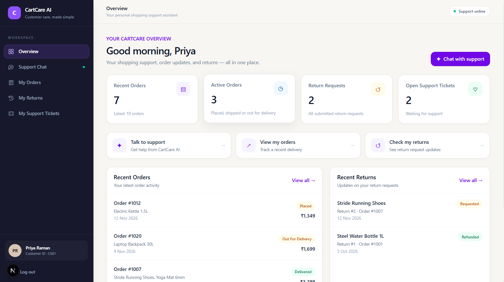
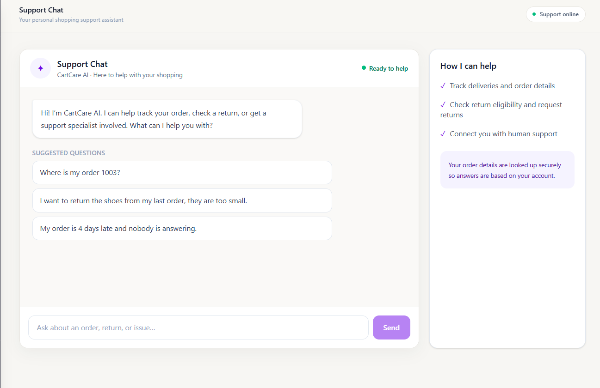
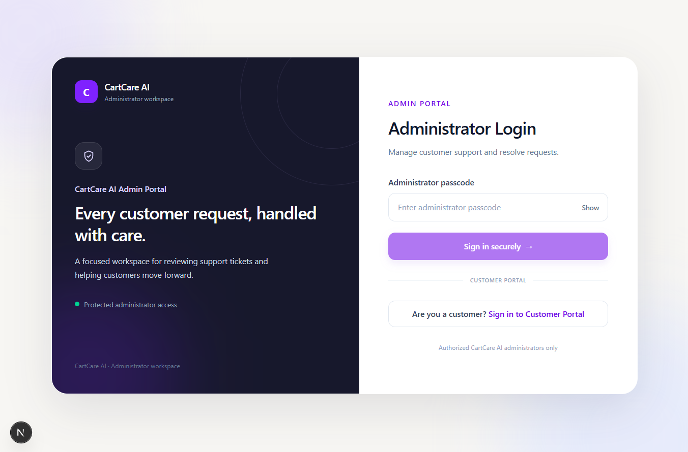
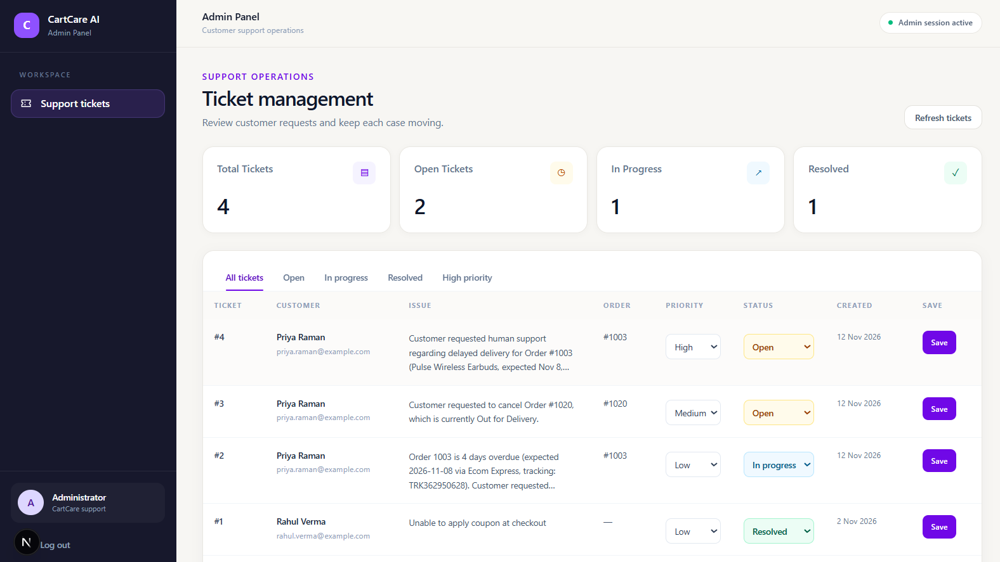

# 🛍️ CartCare AI

### AI-Powered E-Commerce Customer Support Assistant

**Smarter Support. Happier Customers.**

CartCare AI is an AI-powered e-commerce customer support platform that makes shopping support faster and easier. Built using **Next.js, Supabase, and Google Gemini**, it allows customers to track orders, check return eligibility, submit return requests, and escalate unresolved issues through a conversational AI assistant.

The platform also includes a dedicated administrator dashboard where support teams can monitor customer requests, manage ticket priorities, and update resolution statuses.

---

## 📸 Screenshots

### Customer Portal



### Customer Dashboard



### AI Support Chat



### Admin Portal



### Admin Dashboard



---

## ✨ Key Features

### 👤 Customer Portal

- **AI-Powered Support Chat:** Interact with an AI assistant using natural language.
- **Order Tracking:** Check order status, expected delivery dates, courier details, and tracking numbers.
- **Return Eligibility:** Automatically verify return eligibility based on delivery status and product-specific return windows.
- **Return Requests:** Submit return requests directly through the AI assistant.
- **Human Escalation:** Raise support tickets for unresolved or urgent customer issues.
- **My Orders:** View order history and associated products.
- **My Returns:** View submitted return requests and their statuses.
- **My Support Tickets:** Track support requests raised by the customer.

### 🛠️ Admin Portal

- **Admin Dashboard:** Centralized workspace for customer support operations.
- **Ticket Overview:** Monitor total, open, in-progress, and resolved tickets.
- **Ticket Management:** View customer information, issue descriptions, and associated order IDs.
- **Priority Management:** Assign Low, Medium, or High priority to tickets.
- **Status Management:** Update tickets to Open, In Progress, or Resolved.
- **Ticket Filtering:** Filter tickets based on status and priority.
- **Independent Authentication:** Separate administrator login and session management.

---

## 🧠 AI Agent Capabilities

CartCare AI uses a tool-based AI agent architecture powered by Google Gemini.

Instead of generating answers from general knowledge alone, the AI assistant can invoke backend tools to retrieve customer-specific information and perform permitted operations.

### Available AI Tools

| Tool | Function |
|---|---|
| `getMyOrders` | Retrieves the customer's recent orders. |
| `getOrderDetails` | Retrieves details of a specific order. |
| `checkReturnEligibility` | Checks whether a product qualifies for a return. |
| `createReturnRequest` | Creates a return request in the database. |
| `escalateToHuman` | Creates a support ticket for human assistance. |

### Return Policy

A product is eligible for return only when:

1. The order has been delivered.
2. A valid delivery date exists.
3. The return request is within the product's configured return window.

The eligibility is checked on the server before creating a return request.

---

## 🏗️ How It Works

```text
              CUSTOMER
                  |
                  v
          Customer Support Chat
                  |
                  v
          Next.js API Endpoint
                  |
                  v
          Google Gemini Agent
                  |
                  v
          Tool Selection
                  |
        +---------+----------+
        |         |          |
        v         v          v
     Orders    Returns    Escalation
      Tool      Tools       Tool
        |         |          |
        +---------+----------+
                  |
                  v
             Supabase
                  |
                  v
          Tool Execution Result
                  |
                  v
           Gemini Response
                  |
                  v
          Customer Receives
             Response
```

The administrator accesses a separate authenticated dashboard to retrieve and manage support tickets through protected backend APIs.

---

## 🧰 Technology Stack

| Technology | Purpose |
|---|---|
| Next.js 16 | Full-stack React framework |
| React 19 | Frontend user interface |
| TypeScript | Type-safe development |
| Tailwind CSS | UI styling |
| Supabase | PostgreSQL database and backend |
| Google Gemini | AI-powered conversational agent |
| Google GenAI SDK | Gemini model integration |
| Zod | Request and input validation |
| Vercel | Deployment platform |

---

## 📁 Project Structure

```text
CartCare-AI/
│
├── app/
│   ├── admin/
│   │   ├── login/
│   │   └── tickets/
│   │
│   ├── api/
│   │   ├── admin/
│   │   │   ├── login/
│   │   │   ├── logout/
│   │   │   └── tickets/
│   │   ├── agent/
│   │   ├── login/
│   │   ├── orders/
│   │   ├── returns/
│   │   └── support-tickets/
│   │
│   ├── login/
│   ├── globals.css
│   ├── layout.tsx
│   └── page.tsx
│
├── components/
│   ├── AgentChat.tsx
│   ├── OverviewDashboard.tsx
│   ├── OrdersPanel.tsx
│   ├── ReturnsPanel.tsx
│   └── SupportTicketsPanel.tsx
│
├── lib/
│   ├── agent/
│   │   ├── customerContext.ts
│   │   ├── defineTool.ts
│   │   ├── runAgent.ts
│   │   ├── systemPrompt.ts
│   │   ├── tools.ts
│   │   └── types.ts
│   │
│   ├── auth.ts
│   ├── dates.ts
│   ├── env.ts
│   ├── gemini.ts
│   ├── schemas.ts
│   └── supabase.ts
│
├── public/
│   └── screenshots/
│       ├── admin-dashboard.png
│       ├── admin-login.png
│       ├── customer-dashboard.png
│       ├── customer-login.png
│       └── support-chat.png
│
├── seed/
│   └── ps1_ecommerce_support.sql
│
├── proxy.ts
├── .env.example
├── .gitignore
├── package.json
└── README.md
```

---

## ⚙️ Getting Started

### Prerequisites

Make sure you have:

- Node.js (LTS recommended)
- npm
- Git
- A Supabase account
- A Google Gemini API key

### 1. Clone the Repository

```bash
git clone https://github.com/puravv-v/CartCare-AI.git
cd CartCare-AI
```

### 2. Install Dependencies

```bash
npm install
```

### 3. Configure Environment Variables

Create a `.env.local` file in the root directory.

Use `.env.example` as a reference and configure your own credentials.

```env
GEMINI_API_KEY=your_gemini_api_key
GEMINI_MODEL=gemini-3.5-flash

SUPABASE_URL=your_supabase_project_url
SUPABASE_SECRET_KEY=your_supabase_secret_key

APP_PASSCODE=your_customer_passcode
APP_ADMIN_PASSCODE=your_admin_passcode
```

**Important:** Never commit `.env.local` or expose API keys and Supabase secret keys in client-side code.

### 4. Configure Supabase

1. Create a new project in Supabase.
2. Open the SQL Editor.
3. Execute the SQL script located at:

```text
seed/ps1_ecommerce_support.sql
```

4. Configure the Supabase project URL and secret key in `.env.local`.

The SQL script creates the following tables:

- `customers`
- `products`
- `orders`
- `order_items`
- `returns`
- `support_tickets`

It also inserts sample customer, product, order, return, and support ticket data.

### 5. Run the Development Server

```bash
npm run dev
```

Open your browser and navigate to:

```text
http://localhost:3000
```

---

## 🧪 Available Scripts

| Command | Description |
|---|---|
| `npm run dev` | Starts the development server. |
| `npm run build` | Creates the production build. |
| `npm run start` | Starts the production server. |
| `npm run typecheck` | Runs TypeScript checks. |

---

## 💬 Example Customer Queries

Try these prompts in the support chat:

**1. Order Tracking**

> Where is my order 1003?

**2. Return Request**

> I want to return the shoes from my last order, they are too small.

**3. Human Escalation**

> My order is 4 days late and nobody is answering.

The AI assistant uses backend tools to retrieve order details, validate return eligibility, submit return requests, and escalate issues when required.

---

## 🔐 Security

CartCare AI incorporates several security measures:

- Separate customer and administrator authentication.
- Independent customer and admin session cookies.
- Server-side session validation.
- Customer-specific data access restrictions.
- Server-side Supabase database operations.
- Input validation using Zod.
- Protected administrator ticket APIs.
- Restricted ticket updates to permitted fields.
- Environment variables excluded from version control.

---

## 🚀 Future Enhancements

- Individual customer accounts and registration.
- Live courier tracking integrations.
- Email and WhatsApp support notifications.
- Advanced customer support analytics.
- AI-powered ticket categorization.
- Automated response suggestions for support teams.
- Order cancellation for eligible orders.
- Multilingual customer support.

---

## 👨‍💻 Author

**Purav Agarwal**

B.Tech Computer Science and Engineering (AI & ML)

- GitHub: [@puravv-v](https://github.com/puravv-v)
- LinkedIn: [Purav Agarwal](https://www.linkedin.com/in/purav-agarwal-9a95a4351/)

---

## ⭐ Support

If you find this project interesting, consider giving the repository a star!

**CartCare AI — Smarter Support. Happier Customers.**